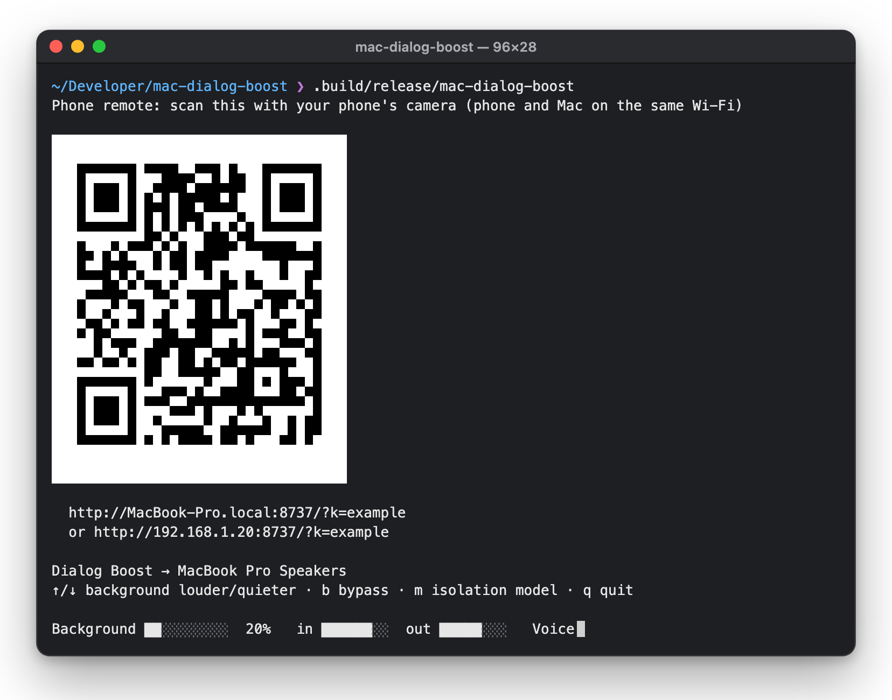
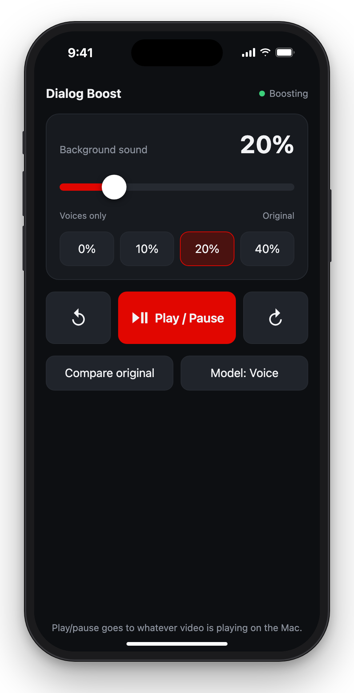

# Mac Dialog Boost

Turn down the noise, keep the voices. Dialog Boost runs everything your Mac plays through
Apple's built-in voice isolation (the engine behind FaceTime and Final Cut's "Voice Isolation"),
so you can hear the people talking without the background drowning them out. Nothing extra to
install.

It works with anything that plays sound on the Mac: a browser, the TV app, YouTube, a video
player. It's handy for:

- **Sports**, e.g. Formula 1: hear the commentators over the engines, and keep some engine
  noise in the background if you like
- **Movies and shows** where the explosions are loud and the dialogue is quiet
- **Videos and podcasts** with heavy background music

A phone remote lets you adjust the mix and pause the video from the couch while the Mac is
plugged into the TV.

<p align="center">
  
  &nbsp;&nbsp;
  
</p>

## Run it

Requires macOS 15 or later. Build once, or again after changing the code:

```bash
swift build -c release
```

Then start it **from the Terminal app** while something is playing:

```bash
.build/release/mac-dialog-boost
```

### One-time permissions

macOS doesn't prompt for system-audio access when you run a command-line tool, so add it
yourself:

1. **System Settings → Privacy & Security → Screen & System Audio Recording**
2. Under **System Audio Recording Only**, click **+** and add **Terminal**
3. Quit and reopen Terminal

Until that's done, the tool shows "waiting for audio… (your sound is unchanged)" and leaves
your Mac's sound alone. Once real audio arrives, it mutes the original and plays the boosted
version.

For **play/pause from your phone**, Terminal also needs **Accessibility** permission. macOS
asks for this the first time you start the tool. If you missed it, go to
**System Settings → Privacy & Security → Accessibility** and turn on Terminal.

### Controls

| Key       | Does                                                            |
| --------- | --------------------------------------------------------------- |
| ↑ / ↓     | More / less background, in 5% steps (`+` / `-` work too)         |
| b         | Bypass: hear the original sound, to compare                      |
| m         | Switch isolation model (Voice / High Quality Voice)              |
| q         | Quit (Ctrl-C also works); your Mac's audio goes back to normal   |

Options:

- `--background 10` sets how much of the original sound stays under the voices (default 20%)
- `--hq` starts in High Quality Voice mode
- `--port 9000` changes the phone remote's port (default 8737)
- `--no-remote` turns the remote off

**Voice** removes more background. **High Quality Voice** removes a little less but may sound
more natural. Both add the same delay, so try each and keep whichever sounds better.

## Phone remote

When it starts, the tool prints a QR code in Terminal. Scan it with your phone's camera; the
phone and Mac need to be on the same Wi-Fi. In Safari, use **Share → Add to Home Screen** so it
opens full screen like an app. The address and access code stay the same between runs, so the
home-screen icon keeps working.

From the phone you can:

- Drag the **background sound** slider, or tap a preset (0 / 10 / 20 / 40%)
- **Play / Pause** whatever video is playing, even full screen (it sends the ⏯ media key)
- **Back / Forward** (the arrow icons): press ← or → in the front window to jump a few seconds
- **Compare original**, or switch the **voice model**

There's deliberately no stop button on the phone, so a stray tap can't turn it off mid-show.
Quit from the Mac with **q** in Terminal.

The link contains a random access code, so other people on your Wi-Fi can't control it
without scanning the QR code. To reset the code, delete
`~/Library/Application Support/MacDialogBoost/remote-token`.

## How it works

1. A system-audio tap captures everything the Mac plays and, once audio is arriving, mutes
   the original.
2. **Leveler:** a compressor squashes sudden loud moments (race starts, explosions, a
   goal-line roar).
3. **Voice isolation:** separates the voices, then blends back the chosen percentage of the
   original sound so you keep some atmosphere.
4. **Limiter:** restores the volume and prevents clipping.

In testing on F1 audio, it handled both synthetic commentary over V6 engine noise and real
broadcast audio:

| Setting        | Synthetic test: engines vs. voice | Real broadcast: engine-only moments |
| -------------- | --------------------------------- | ----------------------------------- |
| Original       | engines 1.6 dB *louder*           | -28 dB                              |
| 20% background | engines ~8 dB *quieter*           | -29 dB                              |
| 10% background | —                                 | -35 dB                              |
| 0% background  | engines effectively gone          | -73 dB (silent)                     |

The voices stay at their original loudness or slightly louder.

## Good to know

- It adds about 85 ms of audio delay. That's unnoticeable over action footage but slightly
  visible as lip sync on close-up talking shots.
- It plays to whatever output was selected when it started. If you switch to headphones or
  AirPods, restart it.
- Isolation keeps anything voice-like, so crowd chants, singing and radio chatter come through
  too and may sound a bit processed.
- To process a recording instead of live audio:
  `mac-dialog-boost process in.wav out.wav --background 15`
